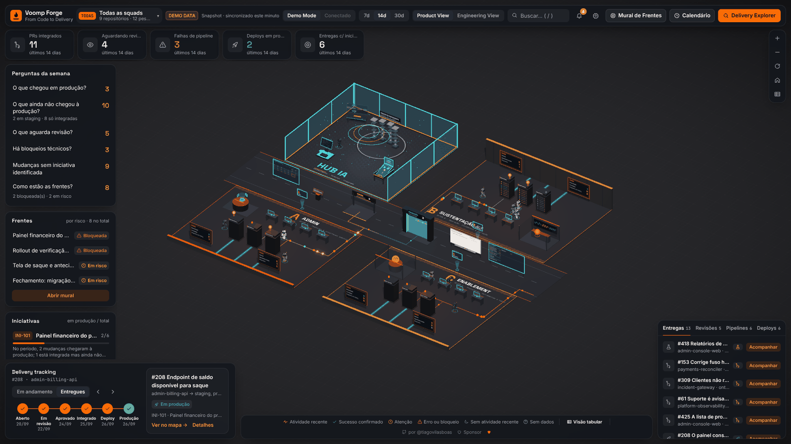
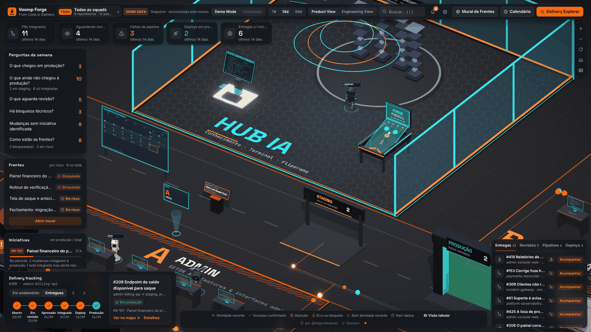
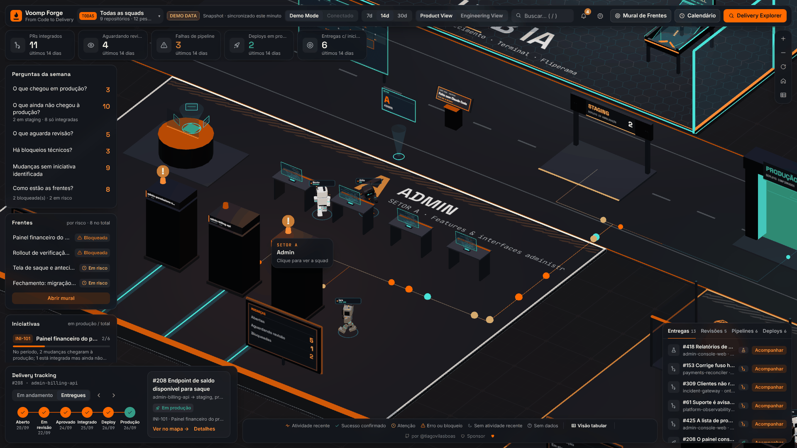
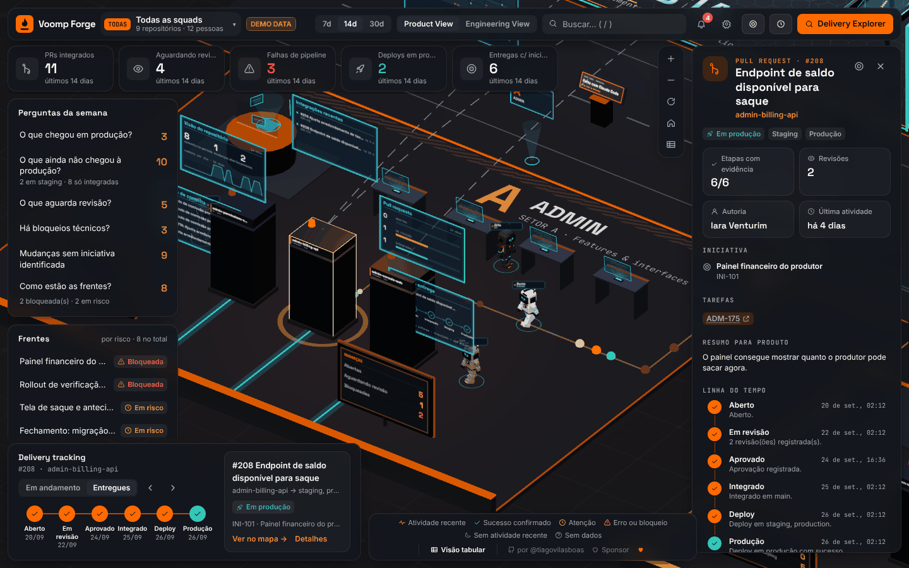
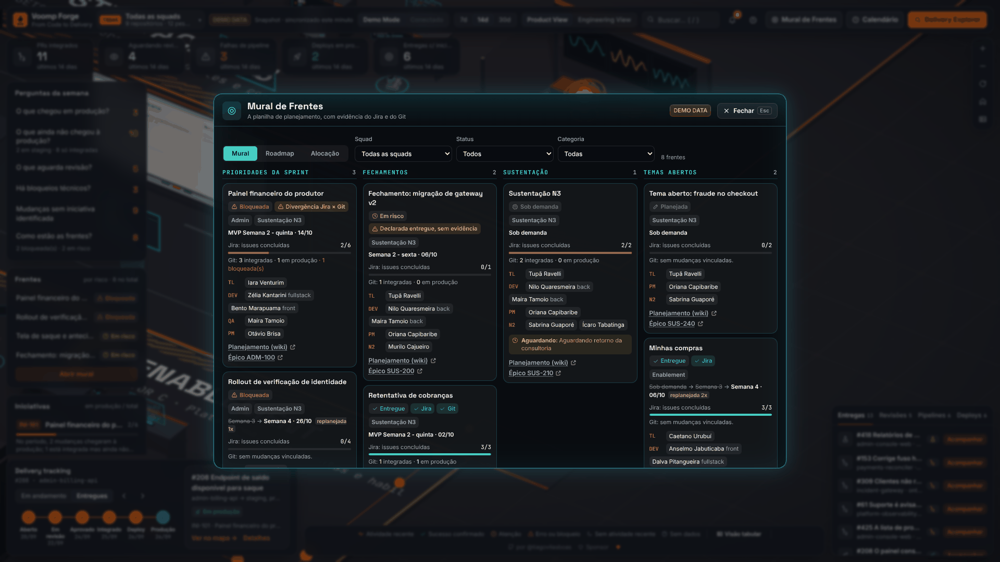
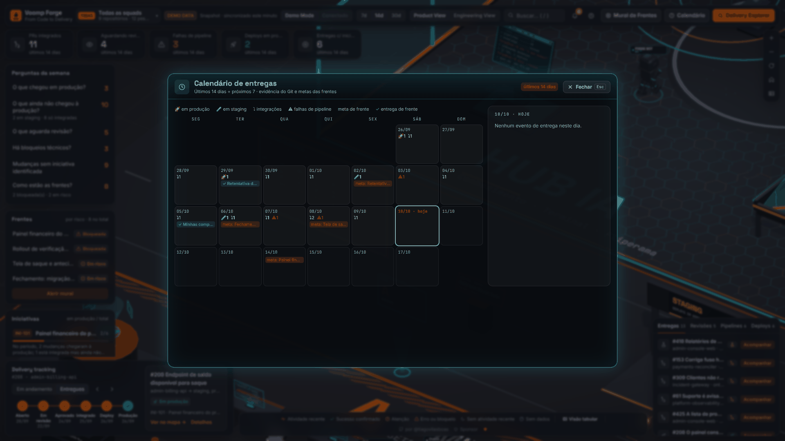
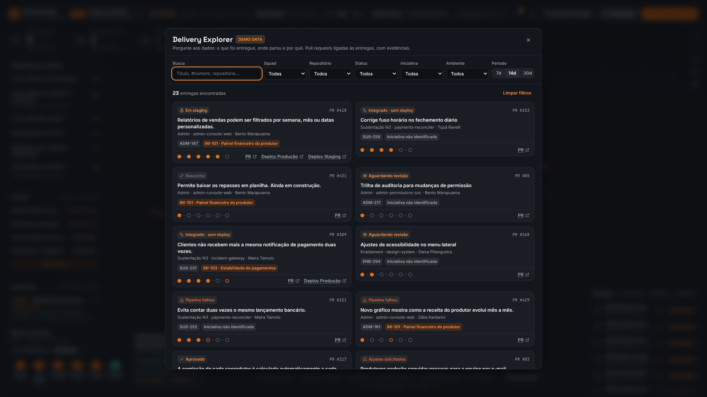
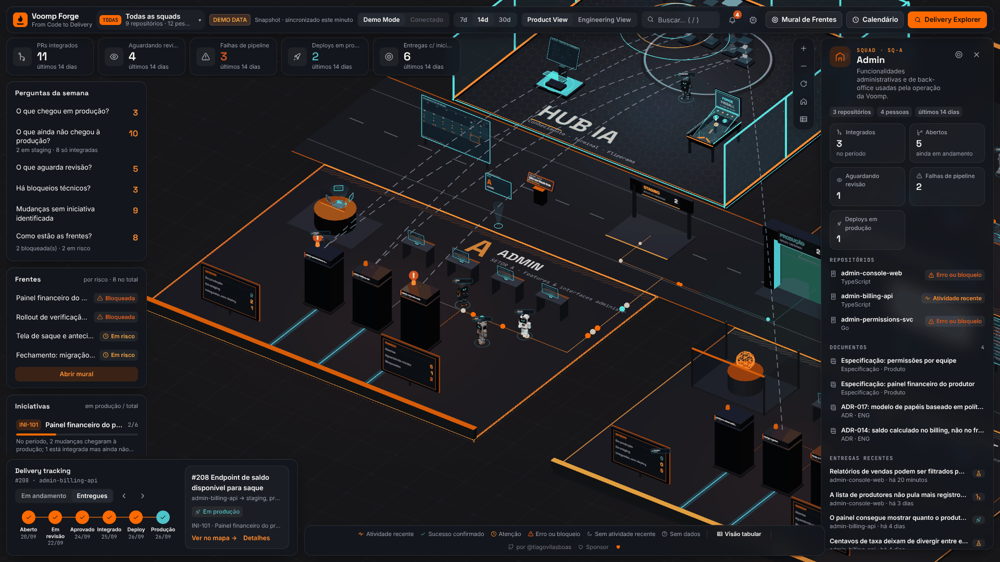
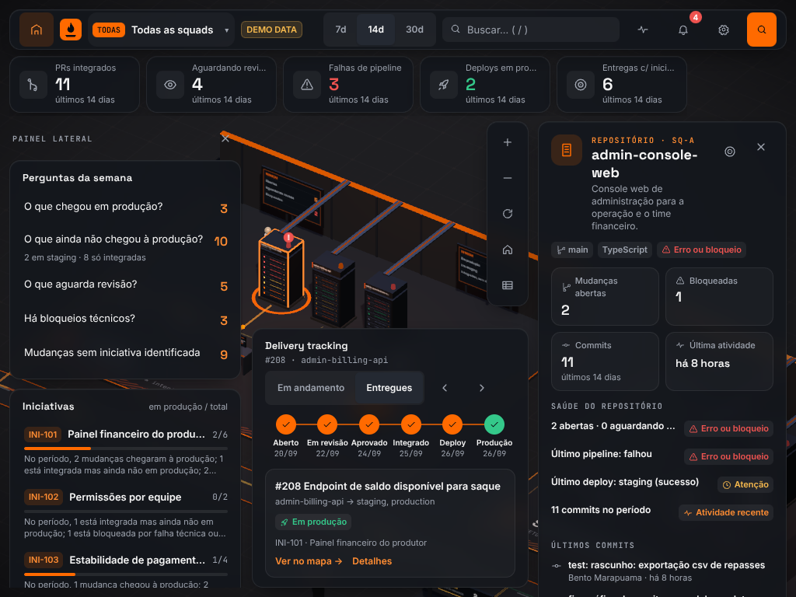
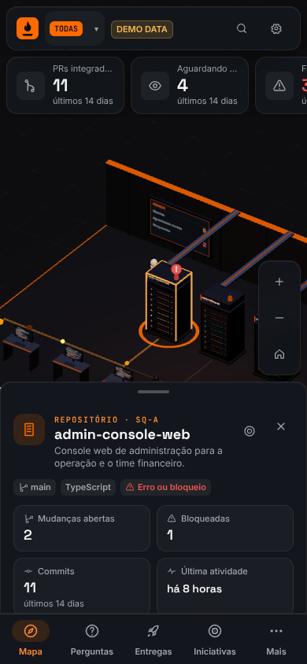

# Voomp Forge

**From Code to Delivery** — Engineering Delivery Intelligence em 3D.

Transforma dados de entrega de software (mudanças, revisões, pipelines e deploys) em um data center 3D explorável, onde cada **setor** é uma squad, cada **rack** é um repositório e a luz que corre pelo chão são eventos de integração e deploy.

[](https://github.com/tiagovilasboas/voomp-forge-3d/actions/workflows/ci.yml)

-f08a24)
-lightgrey)



<p align="center"><a href="https://tiagovilasboas.github.io/voomp-forge-3d/"><b>🚀 Abrir a demo ao vivo</b></a> · <a href="docs/media/voomp-forge-tour.mp4"><b>▶ Tour em vídeo (31 s)</b></a></p>

> **DEMO DATA.** Todos os dados exibidos por padrão são **fictícios**, gerados localmente em `src/infrastructure/demo/`. Nenhuma pessoa, repositório ou número representa a Voomp real.

## Por que

- **Produto pergunta "o que chegou em produção?"** e a resposta costuma sair de planilha, Slack e memória. O Forge responde a partir de registros.
- **Integrado não é produção.** Uma mudança só aparece como em produção quando existe um deploy bem-sucedido que contenha a mudança, com SHA, pipeline e ambiente.
- **Frentes são comprovadas, não declaradas.** Uma frente só fica "entregue" com evidência do tracker (Jira) ou do Git. A planilha apenas declara, e divergências entre fontes são sinalizadas.
- **Ausência de dado não é zero.** Sem fonte, a interface mostra "sem dados", nunca um número fabricado.

## Destaques

- **Data center em grade:** a Hub IA e uma sala por squad, com corredor central e praça de produção (staging, portão e calendário).
- **Racks de repositório** com módulos de mudanças, pipeline, deploy e commits, e hologramas do repositório ao selecionar um rack.
- **Hub IA:** terminal determinístico sobre o snapshot (sem IA), pinball holográfico, Arquivo de Conhecimento ligado a iniciativas e repositórios, mesa de automação com **n8n**, e o **Forge Bot**, um NPC que patrulha o hub.
- **Mural de Frentes:** abas Mural, Roadmap e Alocação, com filtros por squad, status e categoria.
- **Calendário de entregas:** dias com deploys, integrações, falhas de pipeline e metas das frentes.
- **Delivery Explorer:** busca e filtros (squad, repositório, status, iniciativa, ambiente, período) com cards de evidência e linha do tempo de seis etapas por mudança.
- **Androides ilustrativos:** representam funções do time. Não mostram presença, carga de trabalho nem ranking.
- **Product View e Engineering View:** perguntas da semana e saúde técnica, com o vocabulário nativo do provedor (PR ou MR), vindo do snapshot.
- **Responsivo e instalável:** layouts para celular, tablet e desktop, navegação inferior no celular, PWA com uso offline.
- **Conectores plug-n-play:** Git local, Jira, planilha CSV e Confluence geram um snapshot validado. O navegador nunca recebe tokens.
- **Acessível:** visão tabular sem 3D, com fallback automático quando não há WebGL, movimento reduzido e qualidade gráfica ajustável.

## Galeria

<table>
  <tr>
    <td align="center" width="50%"><br><sub>Hub IA: terminal, pinball holográfico e Arquivo de Conhecimento</sub></td>
    <td align="center" width="50%"><br><sub>Setor (squad) com racks, quadros de mudanças e robôs ilustrativos</sub></td>
  </tr>
  <tr>
    <td align="center" width="50%"><br><sub>Mudança selecionada: inspetor com linha do tempo de seis etapas e evidências</sub></td>
    <td align="center" width="50%"><br><sub>Mural de Frentes: prioridades, fechamentos e divergências Jira × Git</sub></td>
  </tr>
  <tr>
    <td align="center" width="50%"><br><sub>Calendário de entregas com evidência do Git e metas das frentes</sub></td>
    <td align="center" width="50%"><br><sub>Delivery Explorer: filtros e cards com evidências</sub></td>
  </tr>
  <tr>
    <td align="center" width="50%"><br><sub>Mesa de automação (n8n) no Hub IA</sub></td>
    <td align="center" width="50%"><br><sub>Layout de tablet</sub></td>
  </tr>
  <tr>
    <td align="center" width="50%"><br><sub>Layout de celular, com navegação inferior</sub></td>
    <td></td>
  </tr>
</table>

## Quickstart

Requisitos: Node 22 (o mesmo usado na CI).

```bash
npm install
npm run dev         # servidor de desenvolvimento (Vite)
npm run typecheck   # tsc -b
npm test            # testes unitários (Vitest)
npm run build       # typecheck + build de produção em dist/
```

### Dados reais (snapshot)

O app não consulta o Git ao vivo. Ele lê um snapshot JSON gerado a partir dos repositórios e das fontes configuradas:

```bash
cp examples/forge.config.example.json forge.config.json   # ajuste as fontes
npm run ingest -- --config forge.config.json --out public/snapshot.json
```

Segredos (tokens) entram só por variáveis de ambiente. Depois, abra o app com `?snapshot=./snapshot.json`. O que é inferido, o que vem de cada fonte e o que ainda não existe está em [docs/INGESTION.md](docs/INGESTION.md).

## Arquitetura

Camadas com regra de dependência explícita:

```
domain  ←  application  ←  { infrastructure, presentation }
```

- `domain`: entidades e regras de evidência, sem dependências.
- `application`: portas (`DeliveryDataSource`, conectores) e consultas (KPIs, filtros, calendário, frentes).
- `infrastructure`: conectores, dados de demonstração e importação de snapshot.
- `presentation`: `world` e `animation` puros (sem React nem Three.js), `scene` (React Three Fiber), `hud` (React) e `state` (Zustand).

Um teste de arquitetura (`src/architecture.test.ts`) impede dependências fora dessa regra. Detalhes em [docs/ARCHITECTURE.md](docs/ARCHITECTURE.md).

## Documentação

- [docs/ARCHITECTURE.md](docs/ARCHITECTURE.md): camadas, fluxo de dados e regras de dependência
- [docs/DESIGN.md](docs/DESIGN.md): design de produto e visual
- [docs/HUD_SPEC.md](docs/HUD_SPEC.md): especificação das regiões do HUD
- [docs/RESPONSIVE_SPEC.md](docs/RESPONSIVE_SPEC.md): especificação de layout responsivo
- [docs/INGESTION.md](docs/INGESTION.md): ingestão e snapshot
- [docs/HANDOFF.md](docs/HANDOFF.md): handoff de engenharia, testes e backlog
- [docs/DECISIONS.md](docs/DECISIONS.md): decisões de arquitetura e produto
- [docs/agents/ORCHESTRATION.md](docs/agents/ORCHESTRATION.md): política de agentes do projeto
- [CHANGELOG.md](CHANGELOG.md): histórico de versões, incluindo a 0.1.0
- [CONTRIBUTING.md](CONTRIBUTING.md): convenção de commits e checagens antes do push

**Limitações conhecidas da 0.1.0:** não há modo conectado (a fonte "Conectado" é um stub desabilitado, sem backend nem autenticação), e a ingestão roda em lote, fora do app. Veja o backlog em [docs/HANDOFF.md](docs/HANDOFF.md).

## Stack

React 19 · TypeScript · Vite · React Three Fiber + drei + postprocessing (Three.js) · Zustand · Tailwind CSS 4 · vite-plugin-pwa · Vitest · GitHub Actions (typecheck, testes e build em cada PR).

## Contribuição

Leia [CONTRIBUTING.md](CONTRIBUTING.md) antes de abrir um PR: commits em Conventional Commits, um commit por domínio e as checagens `npm run typecheck && npm test && npm run build`. O [CLAUDE.md](CLAUDE.md) descreve o acordo de trabalho do projeto.

Licença: ainda não definida (o repositório não tem arquivo `LICENSE`).

## Créditos

Made with love for Voomp by [@tiagovilasboas](https://github.com/tiagovilasboas) · [♥ Sponsor](https://github.com/sponsors/tiagovilasboas)

Feito com Claude Code.

Inspirado na experiência do WareTrack (siddik-web/waretrack). Nenhum código ou asset foi reaproveitado.
